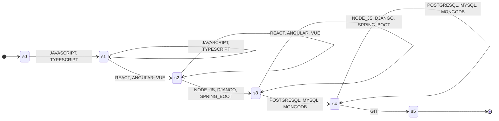
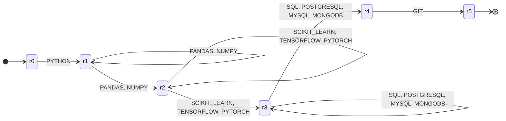
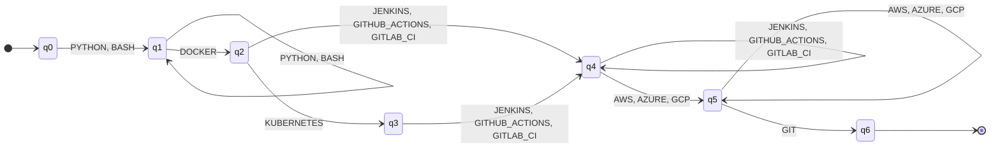
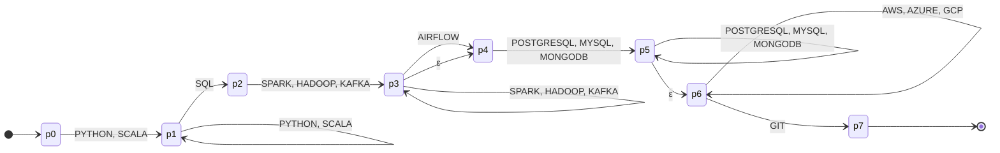

# Stage 3 — Qualification pattern recognition (finite automata)

The input of each automaton is the list of normalized qualifications (stage 2),
filtered and sorted in the canonical order of its profile (`docs/profiles.md`).
Each canonical qualification (for example `DOCKER`) is ONE symbol of the alphabet.
All automata are implemented with pyformlang in `resumelens/recognition/`.

Types used (definitions from the course):
- **DFA**: δ: Q × Σ → Q is a function; each (state, symbol) pair has exactly one next state; no ε-transitions.
- **NFA**: δ: Q × Σ → P(Q); a pair can go to several states or to none (∅); no ε-transitions.
- **ε-NFA**: δ: Q × (Σ ∪ {ε}) → P(Q); it can also move without reading a symbol.

In the DFAs, transitions not drawn go to a trap state (qt, st) that is not accepting
and loops on every symbol; pyformlang rejects missing transitions, which has the same effect.

---

## Profile 1 — Full Stack Developer (`fullstack_automaton.py`)

Pattern: `(JAVASCRIPT|TYPESCRIPT)+ (REACT|ANGULAR|VUE)+ (NODE_JS|DJANGO|SPRING_BOOT)+ (POSTGRESQL|MYSQL|MONGODB)+ GIT`

Meaning: at least one frontend language, one frontend framework, one backend technology,
one database and version control.

M1 = (Q, Σ, δ, s0, F)
- Q = {s0, s1, s2, s3, s4, s5, st}
- Σ = {JAVASCRIPT, TYPESCRIPT, REACT, ANGULAR, VUE, NODE_JS, DJANGO, SPRING_BOOT, POSTGRESQL, MYSQL, MONGODB, GIT}
- s0 = initial state, F = {s5}
- δ (L = {JAVASCRIPT, TYPESCRIPT}, R = {REACT, ANGULAR, VUE}, B = {NODE_JS, DJANGO, SPRING_BOOT}, D = {POSTGRESQL, MYSQL, MONGODB}):

| δ | L | R | B | D | GIT |
|---|---|---|---|---|---|
| s0 | s1 | st | st | st | st |
| s1 | s1 | s2 | st | st | st |
| s2 | st | s2 | s3 | st | st |
| s3 | st | st | s3 | s4 | st |
| s4 | st | st | st | s4 | s5 |
| s5 | st | st | st | st | st |
| st | st | st | st | st | st |

Type: **DFA**. δ is a total function Q × Σ → Q (completed with st) and there are no ε-transitions.

Examples: JAVASCRIPT REACT NODE_JS POSTGRESQL GIT → ACCEPTED. JAVASCRIPT REACT POSTGRESQL GIT → REJECTED (no backend).

---

## Profile 2 — Machine Learning Engineer (`ml_automaton.py`)

Pattern: `PYTHON (PANDAS|NUMPY)+ (SCIKIT_LEARN|TENSORFLOW|PYTORCH)+ (SQL|POSTGRESQL|MYSQL|MONGODB)+ GIT`

Meaning: Python, at least one data library, at least one ML library, at least one
query language or database, and version control.

M2 = (Q, Σ, δ, r0, F)
- Q = {r0, r1, r2, r3, r4, r5}
- Σ = {PYTHON, PANDAS, NUMPY, SCIKIT_LEARN, TENSORFLOW, PYTORCH, SQL, POSTGRESQL, MYSQL, MONGODB, GIT}
- r0 = initial state, F = {r5}
- δ: Q × Σ → P(Q) (P = {PANDAS, NUMPY}, M = {SCIKIT_LEARN, TENSORFLOW, PYTORCH}, S = {SQL, POSTGRESQL, MYSQL, MONGODB}); empty cells are ∅:

| δ | PYTHON | P | M | S | GIT |
|---|---|---|---|---|---|
| r0 | {r1} | | | | |
| r1 | | {r1, r2} | | | |
| r2 | | | {r2, r3} | | |
| r3 | | | | {r3, r4} | |
| r4 | | | | | {r5} |
| r5 | | | | | |

Type: **NFA**. δ returns sets of states: for example δ(r1, PANDAS) = {r1, r2}
(the automaton "guesses" whether more data libraries follow), and many pairs go to ∅.
There are no ε-transitions, so it is an NFA and not an ε-NFA.

Examples: PYTHON PANDAS TENSORFLOW POSTGRESQL GIT → ACCEPTED. PYTHON PANDAS SQL GIT → REJECTED (no ML library).

---

## Profile 3 — DevOps Engineer (`devops_automaton.py`)

Pattern: `(PYTHON|BASH)+ DOCKER KUBERNETES? (JENKINS|GITHUB_ACTIONS|GITLAB_CI)+ (AWS|AZURE|GCP)+ GIT`

Meaning: at least one scripting language, containers, at least one CI/CD tool, at least
one cloud provider and version control. Kubernetes is a plus but not mandatory.

M3 = (Q, Σ, δ, q0, F)
- Q = {q0, q1, q2, q3, q4, q5, q6, qt}
- Σ = {PYTHON, BASH, DOCKER, KUBERNETES, JENKINS, GITHUB_ACTIONS, GITLAB_CI, AWS, AZURE, GCP, GIT}
- q0 = initial state, F = {q6}
- δ (S = {PYTHON, BASH}, C = {JENKINS, GITHUB_ACTIONS, GITLAB_CI}, N = {AWS, AZURE, GCP}):

| δ | S | DOCKER | KUBERNETES | C | N | GIT |
|---|---|---|---|---|---|---|
| q0 | q1 | qt | qt | qt | qt | qt |
| q1 | q1 | q2 | qt | qt | qt | qt |
| q2 | qt | qt | q3 | q4 | qt | qt |
| q3 | qt | qt | qt | q4 | qt | qt |
| q4 | qt | qt | qt | q4 | q5 | qt |
| q5 | qt | qt | qt | qt | q5 | q6 |
| q6 | qt | qt | qt | qt | qt | qt |
| qt | qt | qt | qt | qt | qt | qt |

Type: **DFA**. δ is a total function Q × Σ → Q: every pair has exactly one next state
and there are no ε-transitions. The optional Kubernetes is modeled with two different
symbols leaving q2 (KUBERNETES → q3, CI/CD → q4), so determinism is kept.

Examples: PYTHON BASH DOCKER KUBERNETES JENKINS AWS GIT → ACCEPTED.
PYTHON DOCKER AWS GIT → REJECTED (no CI/CD: from q2, AWS goes to qt).

---

## Profile 4 — Data Engineer (`data_engineer_automaton.py`)

Pattern: `(PYTHON|SCALA)+ SQL (SPARK|HADOOP|KAFKA)+ AIRFLOW? (POSTGRESQL|MYSQL|MONGODB)+ (AWS|AZURE|GCP)* GIT`

Meaning: a programming language plus SQL, at least one data-processing technology,
at least one database and version control. Airflow and cloud are optional.

M4 = (Q, Σ, δ, p0, F)
- Q = {p0, p1, p2, p3, p4, p5, p6, p7}
- Σ = {PYTHON, SCALA, SQL, SPARK, HADOOP, KAFKA, AIRFLOW, POSTGRESQL, MYSQL, MONGODB, AWS, AZURE, GCP, GIT}
- p0 = initial state, F = {p7}
- δ: Q × (Σ ∪ {ε}) → P(Q) (L = {PYTHON, SCALA}, P = {SPARK, HADOOP, KAFKA}, D = {POSTGRESQL, MYSQL, MONGODB}, N = {AWS, AZURE, GCP}); empty cells are ∅:

| δ | L | SQL | P | AIRFLOW | D | N | GIT | ε |
|---|---|---|---|---|---|---|---|---|
| p0 | {p1} | | | | | | | |
| p1 | {p1} | {p2} | | | | | | |
| p2 | | | {p3} | | | | | |
| p3 | | | {p3} | {p4} | | | | {p4} |
| p4 | | | | | {p5} | | | |
| p5 | | | | | {p5} | | | {p6} |
| p6 | | | | | | {p6} | {p7} | |
| p7 | | | | | | | | |

Type: **ε-NFA**. δ is defined over Σ ∪ {ε} and returns sets of states: there are
ε-transitions (p3 → p4 skips the optional AIRFLOW, p5 → p6 enters the optional cloud
section) and many pairs go to ∅. The ε-transitions model optional qualifications
without duplicating states.

Examples: SCALA SQL KAFKA MONGODB GIT → ACCEPTED (uses both ε-transitions).
PYTHON SPARK POSTGRESQL GIT → REJECTED (no SQL).
